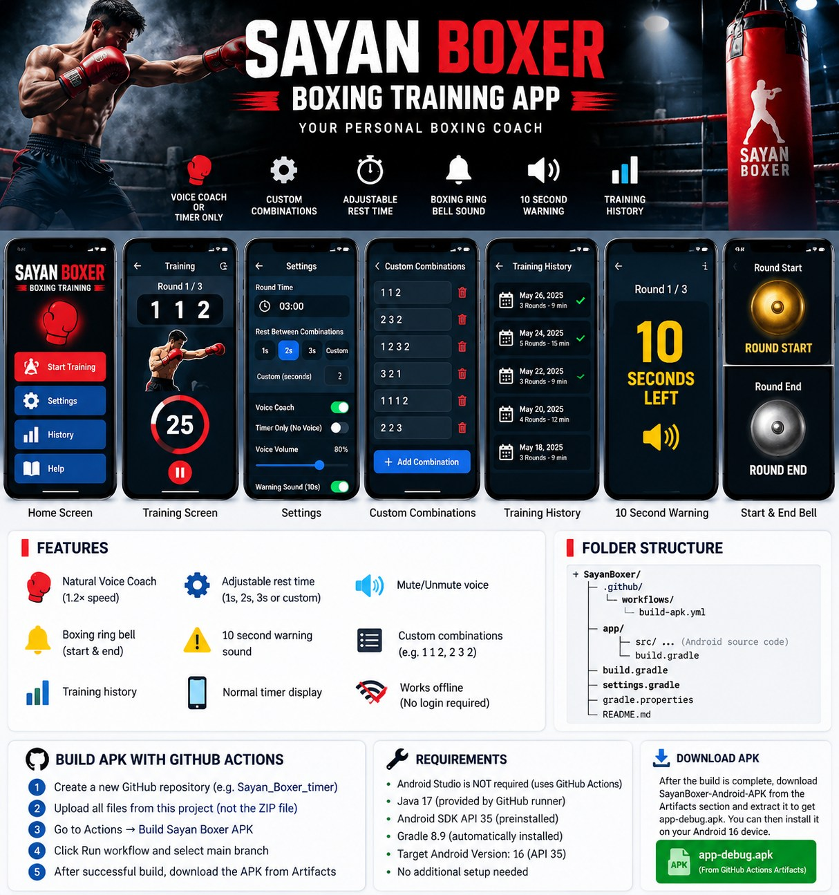

<div align="center">


# 🥊 Sayan Boxer — Boxing Training App

**Offline number-only boxing combination coach and round timer for Android**  
*Built by Sayan Boxer · Version 2.0*

**Voice Coach** · **Custom Combinations** · **Adjustable Timing** · **Boxing Bells** · **Timer Only**

</div>

## 👀 App preview



> **Preview note:** The artwork above is a concept illustration, **not screenshots of a compiled or installed APK**. The Android source code is included in this repository and may display differently. The project has not yet been compiled or tested on a physical device.

## 🥊 What the app does

Train with an offline coach that speaks punch **numbers only**. For example, the app says **“one, one, two”**, and then **“two, three, two”**. It does not say “jab”, “cross” or “hook” while calling combinations.

| Feature | Description |
|---|---|
| 🔊 Number coach | Bundled synthetic natural-sounding voice recordings for **1–6**, prepared at **1.2×** speed |
| ⏱️ Combination gap | Select **1, 2, 3 seconds** or enter a custom delay **after a full combination ends** |
| 🥊 Custom combinations | Add your own sequences such as `1 1 2`, `2 3 2`, or `1 2 3 2` |
| 🔀 Order | Play saved combinations in order or use random combinations |
| 🔔 Ring bell | Boxing bell effects at the beginning and end of rounds |
| ⚠️ Ten-second alert | A separate sound when 10 seconds remain in a round |
| 🔇 Timer only | Disable number voice coaching and use a normal round timer |
| 📱 Background workout | Foreground service with notification for ongoing training |
| 📈 History | Save workout history locally on the device |
| 🔒 No login | Offline app with no account required |

### Punch number guide

| Number | Punch |
|:--:|---|
| **1** | Jab |
| **2** | Cross |
| **3** | Lead hook |
| **4** | Rear hook |
| **5** | Lead uppercut |
| **6** | Rear uppercut |

## 📦 Build an APK using GitHub Actions (easiest)

**You do not need Android Studio for this method.** GitHub Actions builds the app on an online Linux runner.

1. Download this project's ZIP, then **extract it** on your computer.
2. Create a repository on [GitHub](https://github.com/new), for example `Sayan_Boxer_timer`.
3. Upload **everything inside the extracted folder**, including the hidden `.github` folder. The files `settings.gradle`, `build.gradle`, and `app/` must appear at the **top level** of the repository. Do **not** upload only the ZIP as a file.
4. Check that the YAML file appears at **`.github/workflows/build-apk.yml`**. If GitHub's web uploader does not keep hidden folders, create that path with **Add file → Create new file**, then paste the YAML from this project.
5. Open the repository's **Actions** tab. Select **Build Sayan Boxer APK**, then select **Run workflow**, choose the `main` branch, and start it.
6. Open the completed workflow run. If it is successful, find the **Artifacts** section and download **`SayanBoxer-Android-APK`**.
7. Unzip the artifact on your computer. It should contain **`app-debug.apk`**. Copy it to your Android phone and tap it to install. Android may ask you to authorize installation from that source.

**Important:** A green run means the debug APK built successfully. If the build fails, click the failing step and copy its error message. The provided workflow **has not yet been executed and verified** on this project.

### Expected folder structure

```text
Sayan_Boxer_timer/
├── .github/
│   └── workflows/
│       └── build-apk.yml
├── app/
│   ├── build.gradle
│   └── src/
│       └── main/
├── assets/
│   ├── sayan-boxer-banner.jpg
│   └── sayan-boxer-ui-preview.jpg
├── build.gradle
├── gradle.properties
├── settings.gradle
└── README.md
```

### Build locally (optional)

If you want to build or modify the app on your own computer, use **JDK 17**, **Gradle 8.9**, **Android Gradle Plugin 8.7.3**, **Android SDK Platform 35**, and **Build Tools 35.0.0**. Import this folder into Android Studio, sync Gradle, and build `:app:assembleDebug`.

The app currently uses `minSdk 26`, `compileSdk 35`, and `targetSdk 35`. **Android 16 device compatibility still requires a real device test**; building with API 35 does not itself guarantee compatibility with every Android 16 device.

## 🧩 Project files

- `app/src/main/java/com/sayanboxer/boxing/` — native Java user interface and workout logic.
- `app/src/main/res/raw/` — bundled voice numbers, round bells, and warning sound.
- `.github/workflows/build-apk.yml` — GitHub Actions debug APK build and artifact upload.
- `assets/` — GitHub README images (these are not required for the Android build).

## ⚠️ Safety and release notes

Start with short rounds and suitable intensity. Use proper technique and safety equipment for bag work. Stop if you experience pain, dizziness, or unusual breathlessness.

This repository generates a **debug-signed test APK**, not a Play Store-ready release. Do not publish it as a finished production app without testing, signing, privacy review, and completing any applicable store requirements.

---

<div align="center"><strong>🥊 SAYAN BOXER — Train smarter. Punch stronger.</strong></div>
